# Sketch2Shape AI — From a 2D Sketch to a 3D Asset

> TechZephyr 4.0 · IIT Bhubaneswar · 24-Hour Live Hackathon · Computer Vision & Generative AI

Sketch2Shape AI turns a single rough 2D sketch (drawn in-app or uploaded) plus an **optional** text prompt into a
**textured, exportable 3D model** (`.glb` + `.obj`), with an interactive 3D preview in the browser.

---

## 1. Objective

Bridge the gap between a rough visual concept and a usable 3D digital asset by chaining computer vision,
generative AI and 3D reconstruction in one reproducible application:

- Input: hand-drawn canvas sketch **or** uploaded image (PNG/JPG/WEBP), optional prompt.
- Output: real 3D geometry with colour/texture, exported as `.glb` and `.obj`, validated automatically.
- The generated image is **conditioned on the sketch's contours** (ControlNet), so the result stays related to
  the drawing instead of being a purely text-driven object.

## 2. Features

| Requirement (problem statement) | Where it is implemented |
|---|---|
| In-app sketching (brush, eraser, reset) | `app.py` – `gr.Sketchpad` |
| Image upload | `app.py` – `gr.Image(sources=["upload"])`, CLI `--input` |
| Input preparation (resize, background, contrast, noise) | `sketch2shape/preprocess.py` |
| Optional text prompt (never required) | `sketch2shape/generate.py` – falls back to a neutral default prompt |
| Sketch-guided generation | `sketch2shape/generate.py` – SD 1.5 + ControlNet (scribble) |
| Background removal / foreground isolation | `sketch2shape/prepare.py` – rembg (U²-Net) |
| Image-to-3D with texture | `sketch2shape/reconstruct.py` – InstantMesh (Zero123++ → LRM) |
| Mesh validation + export (.glb/.obj) | `sketch2shape/export.py` – trimesh, round-trip check |
| Interactive 3D preview + download | `app.py` – `gr.Model3D`, `gr.File` |
| Timing + hardware report | `report.json` per run, shown in the UI |

## 3. Architecture

```mermaid
flowchart LR
    A[Canvas drawing<br/>or uploaded image] --> B[Preprocess<br/>illumination fix, denoise,<br/>Otsu, crop, square, resize]
    B --> C[Scribble control map<br/>white lines on black]
    C --> D[Stable Diffusion 1.5<br/>+ ControlNet scribble<br/>+ optional prompt]
    D --> E[rembg background removal<br/>center + scale foreground]
    E --> F[InstantMesh<br/>Zero123++ multi-view -> LRM]
    F --> G[Validate with trimesh<br/>non-empty, volume, finite bounds]
    G --> H[model.glb + model.obj<br/>+ texture + report.json]
    H --> I[3D viewer / download]
```



### Pipeline stages

| # | Stage | Technique | Key decisions |
|---|---|---|---|
| 1 | Input conditioning | OpenCV: alpha-flatten on white, morphological illumination correction, Non-local-means denoise, Otsu threshold, speck removal, tight crop → square → 512² | Works for canvas strokes, scans and phone photos; rejects blank/too-faint sketches with a clear message |
| 2 | Sketch-guided image | `StableDiffusionControlNetPipeline` with `lllyasviel/sd-controlnet-scribble`, UniPC scheduler, 25 steps | Prompt is *appended* with a "single object, white background, studio render" suffix so output suits reconstruction; `control_scale` exposes sketch adherence |
| 3 | Image preparation | rembg U²-Net, crop to alpha bbox, foreground fills 85 % of frame, composited on white | Centered object on clean white is what multi-view diffusion expects |
| 4 | Image → 3D | InstantMesh (`instant-mesh-large`), run as an isolated subprocess with `--export_texmap` | Subprocess isolates pinned CUDA deps and frees VRAM after each run |
| 5 | Validate & export | trimesh: vertex/face count, finite bounds, flatness ratio (rejects flat planes), watertight flag, texture flag; OBJ → GLB then **re-open the GLB** | Guarantees the file judges receive actually opens and has real volume |

## 4. Repository structure

```
sketch2shape-ai/
├── app.py                    # Gradio web app (draw / upload / prompt / 3D preview / download)
├── run_pipeline.py           # Command-line entry point
├── requirements.txt          # main app venv (newer Diffusers + Gradio 4)
├── scripts/
│   ├── setup.sh              # two venvs + InstantMesh (pinned) + weights
│   ├── download_weights.py
│   └── make_example_sketches.py
├── sketch2shape/             # five pipeline stages + orchestration
├── examples/inputs/          # chair.png, mug.png, car.png
├── examples/outputs/         # copy a GPU run here before submission
└── third_party/InstantMesh/  # cloned by setup.sh (gitignored)
```

Two virtualenvs keep CUDA pins from colliding:

| Env | Purpose |
|---|---|
| `.venv` | Gradio app, OpenCV, rembg, SD 1.5 + ControlNet (current Diffusers) |
| `.venv-instantmesh` | InstantMesh `run.py` with its own `diffusers==0.20.2` + nvdiffrast |

## 5. Hardware assumptions and runtime

> **Fill in the measured values before submitting** — judges require them. Every run writes
> `outputs/<run>/report.json` with GPU name, VRAM and per-stage timings; copy numbers from there.

| Item | Recommended | Minimum (slower) |
|---|---|---|
| OS | Ubuntu 22.04 | Ubuntu 20.04 / WSL2 |
| Python | 3.10 | 3.10 |
| GPU | NVIDIA, ≥ 24 GB VRAM, CUDA 12.1 | NVIDIA 12–16 GB with `S2S_LOW_VRAM=1` and `instant-mesh-base.yaml` |
| RAM | 32 GB | 16 GB |
| Disk | ~25 GB (weights + env) | ~25 GB |
| Internet | Needed once for `setup.sh` | — |

| Measured on `<your GPU>` | Time |
|---|---|
| Preprocess | _fill from report.json_ s |
| SD + ControlNet (25 steps) | _fill_ s |
| Background removal | _fill_ s |
| InstantMesh reconstruction | _fill_ s |
| Validate + export | _fill_ s |
| **Total** | **_fill_ s** |

CPU-only and Apple Silicon are **not** supported for stage 4 (InstantMesh needs CUDA + nvdiffrast). On a Mac you can install the UI and run preprocess checks; copy the repo to an NVIDIA Linux box for a full generation.

## 6. Installation

```bash
git clone <your-repo-url> sketch2shape-ai
cd sketch2shape-ai
bash scripts/setup.sh          # two venvs, PyTorch cu121, InstantMesh @ 8079d91, weights
source .venv/bin/activate
```

`setup.sh` clones InstantMesh and checks out `8079d9136d738e2c016f4ba4a6bc916d52147761`.

Environment variables (all optional):

| Variable | Default | Purpose |
|---|---|---|
| `INSTANTMESH_DIR` | `third_party/InstantMesh` | Location of the InstantMesh checkout |
| `INSTANTMESH_PYTHON` | `.venv-instantmesh/bin/python` | Interpreter that runs InstantMesh |
| `INSTANTMESH_CONFIG` | `configs/instant-mesh-large.yaml` | Use `instant-mesh-base.yaml` for lower VRAM |
| `S2S_LOW_VRAM` | `0` | `1` = CPU offload for SD and unload before reconstruction |
| `S2S_OUTPUT_DIR` | `outputs/` | Where runs are saved |
| `HF_HOME` | HF default | Weight cache location |

## 7. Usage

### Web app

```bash
python app.py        # open http://localhost:7860
```

1. Draw on the canvas (brush / eraser / clear) **or** upload a sketch image (upload takes priority).
2. Optionally type a prompt, e.g. `red leather armchair, matte finish`.
3. Click **Generate 3D**. Watch the four intermediate stages, rotate the model, download `.glb` / `.obj`.

### Command line

```bash
python run_pipeline.py --input examples/inputs/chair.png --prompt "wooden chair, oak finish" --seed 42
# results in outputs/<timestamp>-<id>/
```

Validate any exported file independently:

```bash
python -m sketch2shape.export outputs/<run>/model.glb
```

### Inputs and outputs

| | Details |
|---|---|
| Input | PNG / JPG / WEBP sketch (dark strokes on light background works best; transparent PNGs are flattened on white). Optional prompt ≤ ~75 tokens. |
| `01_sketch_clean.png` | Denoised, cropped, squared sketch |
| `02_control_map.png` | ControlNet scribble map |
| `03_generated.png` | Sketch-guided generated image |
| `04_prepared.png` / `_rgba.png` | Background-removed input to the 3D stage |
| `model.glb` | Final textured mesh (open in Blender, three.js, Windows 3D Viewer, etc.) |
| `model.obj` + `.mtl` + `.png` | Same mesh with texture map |
| `report.json` | Prompt, seed, hardware, per-stage timings, mesh statistics |

Open in Blender: **File → Import → glTF 2.0 (.glb/.gltf)**.

## 8. Models, APIs and third-party components (disclosure)

No external paid APIs or cloud services are used at inference time; everything runs locally after the one-time weight download.

| Component | Use | Source | License (verify before redistribution) |
|---|---|---|---|
| Stable Diffusion 1.5 | Image generation | `stable-diffusion-v1-5/stable-diffusion-v1-5` | CreativeML OpenRAIL-M |
| ControlNet scribble | Sketch conditioning | `lllyasviel/sd-controlnet-scribble` | CreativeML OpenRAIL-M |
| rembg (U²-Net) | Background removal | github.com/danielgatis/rembg | MIT |
| InstantMesh | Image → textured mesh | github.com/TencentARC/InstantMesh | Apache-2.0 |
| Zero123++ v1.2 | Multi-view generation (inside InstantMesh) | `sudo-ai/zero123plus-v1.2` | see model card |
| Diffusers, PyTorch, OpenCV, trimesh, Gradio | Libraries | PyPI | permissive |

Note: the Stable Diffusion safety checker is disabled (`safety_checker=None`) to avoid false-positive black images on
product sketches; the app only processes user-supplied sketches and a fixed prompt template.

## 9. Limitations

- **Single-view ambiguity:** hidden sides are inferred by Zero123++/LRM, so the back of an object is plausible, not exact.
- **Sketch quality:** very sparse, tiny or heavily overlapping strokes can yield an unrelated generated image. Raise *Sketch adherence* or add a short prompt naming the object.
- **Single object only:** scenes with several objects tend to merge or lose parts.
- **Thin structures** (chair legs, handles, wires) may be fused or thickened.
- **Texture:** the baked texture is ~1024², sufficient for preview, not production shading; no PBR maps.
- **Mesh topology:** triangle soup from marching cubes — not 3D-print-ready, not animation-ready (outside mandatory scope).
- **Runtime/VRAM:** needs an NVIDIA GPU; first run is slower due to weight loading.
- **Orientation/scale:** exported with InstantMesh conventions; rotate/scale in your 3D tool if needed.

## 10. Troubleshooting

| Symptom | Fix |
|---|---|
| `InstantMesh not found` | Run `bash scripts/setup.sh` or set `INSTANTMESH_DIR` |
| `CUDA out of memory` | `export S2S_LOW_VRAM=1` and/or `INSTANTMESH_CONFIG=configs/instant-mesh-base.yaml` |
| `nvdiffrast` build errors | Install CUDA toolkit matching PyTorch (12.1) and `build-essential`; re-run `pip install -r third_party/InstantMesh/requirements.txt` |
| "no visible strokes / too faint" | Use dark, bold strokes on a light background |
| Generated image is the wrong object | Add a prompt naming the object, or change `--seed` |
| "Could not isolate a foreground object" | Change seed; prompt `single object on white background` |
| Mesh rejected as flat | Re-run with another seed; check the prepared image shows a full object |
| HF download blocked | Run `python scripts/download_weights.py` on a connected machine and copy the `HF_HOME` cache |
| InstantMesh CLI flag errors | Its CLI changed between commits; `git -C third_party/InstantMesh checkout <known-good-sha>` and update `reconstruct.py` flags |

## 11. Reproducibility checklist

- [x] Single entry point per mode: `python app.py` or `python run_pipeline.py --input ...`
- [x] All dependencies pinned (`requirements.txt`, `scripts/setup.sh`)
- [x] Weight pre-fetch script (`scripts/download_weights.py`)
- [x] Seeds exposed (`--seed`, UI field) for repeatable generations
- [x] Automatic mesh validation + GLB round-trip on every run
- [x] Sample sketches in `examples/inputs/` (`chair.png`, `mug.png`, `car.png`)
- [x] InstantMesh pinned to `8079d9136d738e2c016f4ba4a6bc916d52147761` in `scripts/setup.sh`
- [ ] Copy one GPU run into `examples/outputs/` (`.glb` / `.obj` / `report.json`)
- [ ] Fill measured timing/hardware table (section 5) from that `report.json`

## 12. Team

| Name | Role |
|---|---|
| Prayash Prasad Panda | Engineering |

## 13. Acknowledgements

TencentARC (InstantMesh), SUDO AI (Zero123++), Lvmin Zhang (ControlNet), Hugging Face (Diffusers), Daniel Gatis (rembg), Mike Dawson (trimesh).
